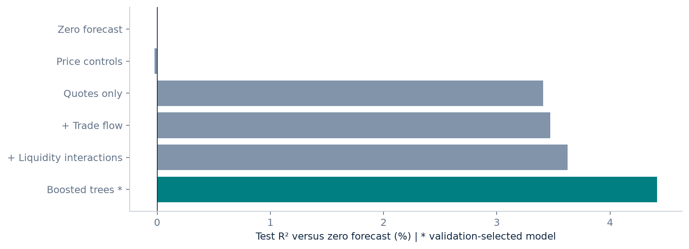
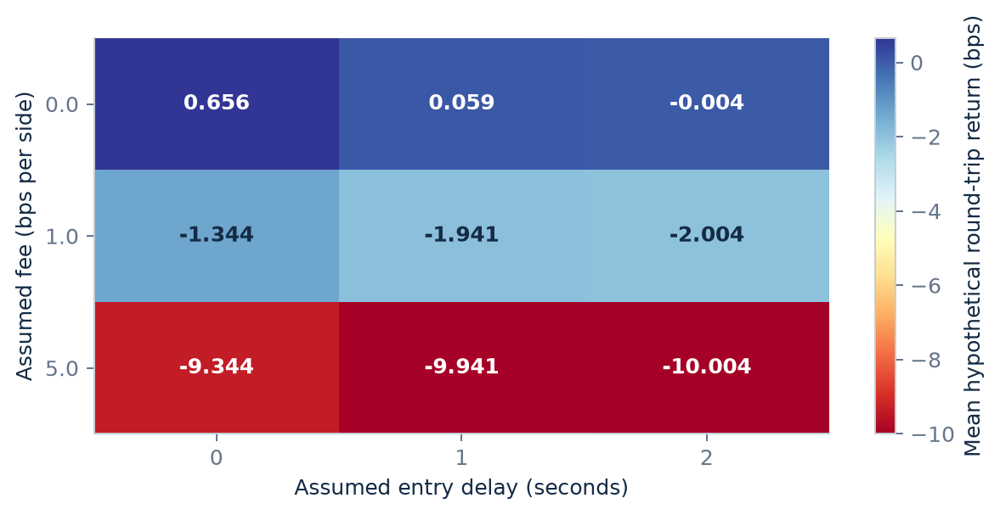

# When does order flow predict prices?

**Liquidity, signal persistence and the cost of acting on a forecast.**

An independent, AI-assisted quantitative research project using real BTCUSDT
and ETHUSDT perpetual-futures best quotes and aggregate trades from Binance
Vision, **January 1-14, 2024**. The project examines questions relevant to
market-making research: short-horizon prediction, liquidity dependence,
signal decay, and the difference between statistical information and economic value.

[Read the research report](output/pdf/orderflow-research.pdf) ·
[Research protocol](docs/research_protocol.md) ·
[English presentation / 中文导读](docs/presentation-guide.md) ·
[LinkedIn draft](docs/linkedin-draft.md)

## Main finding

The validation-selected boosted-tree model achieves **4.416% test R²
relative to zero prediction** and **4.437% lower MSE than
price-control Ridge**. The economic diagnostic is much less encouraging:
a one-second delay and one basis point of fees per side produce **-1.941 bps**
mean hypothetical return per five-second round trip.

**Predictive information exists in this sample; economically tradable alpha
has not been established.** Only four held-out UTC days are available.



## What was actually completed

- Verified 56 official ZIP archives against vendor SHA-256 checksums.
- Processed **538,977,734 quote updates** and **40,271,937 aggregate-trade records** in bounded-memory chunks.
- Detected and repaired an interleaved source archive before model fitting;
  all records were retained after ordering, with no date removed.
- Built causal BBO imbalance, event-level OFI, lagged signed-trade, liquidity,
  return and activity features before chronological evaluation.
- Compared six fixed candidates, including zero, price controls, quote-only
  ablation, full-flow Ridge, liquidity-interaction Ridge and boosted trees.
- Used 7 training days, 3 validation days and 4 final-test days, with no random split.
- Evaluated signal horizons, calibration, daily stability, and explicit spread,
  fee and delay scenarios.
- Generated the PDF, HTML and Markdown report directly from machine-readable results.

Data cost: **$0**. Authorized data ceiling: **$100**, entirely unspent.

## Evidence at a glance

| Item | Result / convention |
| --- | --- |
| Main target | Next-second midpoint simple return, bps |
| Training | Jan 1-7; every fifth second; 241,421 eligible anchors |
| Validation | Jan 8-10; 518,023 anchors |
| Final test | Jan 11-14; 690,678 anchors |
| Selected model | Histogram gradient boosting, chosen only by validation MSE |
| Zero-fee, zero-delay scenario | +0.656 bps mean, after crossing quoted spreads |
| Zero-fee, 1-second-delay scenario | +0.059 bps mean |
| 1 bp each side, 1-second-delay scenario | -1.941 bps mean |
| Uncertainty unit | UTC day, both correlated assets together; only four test clusters |
| Executions | Hypothetical quote crossings; no actual fills or passive queue model |



## Reproduce

Use Python 3.11 or newer and `curl`. No exchange account or API key is needed.
The full data download is approximately **5.96 GB compressed**. Allow about
15 GB working storage for archives, processed data and temporary sorting.
The pipeline uses two download/processing workers and a disk-backed sort for
one interleaved archive; runtime depends on network and hardware.

```bash
python3 -m venv .venv
source .venv/bin/activate
python -m pip install -e '.[dev]'
python -m pytest -q
python run.py data
# Original research outputs are committed and protected against overwrite.
python run.py research --output tmp/reproduced-results
# Rebuild the presentation artifacts from the original committed results.
python run.py report
```

On Windows, activate with `.venv\Scripts\activate` and use a shell with `curl`.
`run.py` supports Python distributions that do not process editable-install
`.pth` files. `requirements.lock.txt` records exact packages from this run;
`pyproject.toml` specifies the supported dependency set.

For a completely fresh experiment, use a separate output directory and preserve
its configuration and results. Repeated runs after seeing the test set do not
create a new unseen holdout. Report generation never fits models.

## Repository map

| Path | Purpose |
| --- | --- |
| `src/orderflow/data.py` | Checksummed acquisition, canonical ordering, causal second-grid aggregation |
| `src/orderflow/research.py` | Features, chronological splits, fixed models, evaluation and costs |
| `src/orderflow/report.py` | Figures and report generation from saved results |
| `configs/study.json` | Instruments, dates, timing assumptions and budget |
| `data/audit/` | Per-day audits, source URLs and hashes |
| `results/` | Frozen configuration, metrics, coefficients and fitted models |
| `docs/` | Protocol, data dictionary, experiment log, report and presentation material |
| `output/pdf/` | Shareable 8-page research report |
| `tests/` | Causality, ordering, boundary and accounting checks |

Raw archives, full processed observations and per-observation predictions are
local generated files excluded from Git. All official raw URLs are in the
committed audit manifests. Synthetic values appear only in correctness tests,
not in empirical results.

## Interpretation and limits

The quote-only baseline already explains most of the measured linear-model
improvement. Trade features add less. Liquidity interactions have inconsistent
validation/test benefits. The one-second forecast correlation declines at
longer horizons, and even modest fees dominate the quoted-crossing advantage.

This is **a short historical crypto microstructure study**, not a US equity
strategy or live HFT system. BBO event time is a publication proxy; trade
availability assumes a 1,000 ms lag. There is no actual local receive clock.
Funding, impact, extra slippage, queue priority, margin and capital constraints
are not modeled. The markout figure is explicitly a hypothetical quote-side
proxy, not an actual execution-conditioned maker markout. No Sharpe ratio,
realized profit, firm affiliation or hiring outcome is claimed.

The four-day bootstrap is descriptive, with too few clusters for a strong
significance claim. A longer independent date range and separately licensed
US equity data are documented in the [upgrade plan](docs/data_upgrade_plan.md).

## Sources, licensing and contributions

- [Cont, Kukanov & Stoikov: The Price Impact of Order Book Events](https://arxiv.org/abs/1011.6402)
- [Gould & Bonart: Queue Imbalance as a One-Tick-Ahead Price Predictor](https://arxiv.org/abs/1512.03492)
- [Binance public-data documentation](https://github.com/binance/binance-public-data)
- [Binance Vision Dataset Terms](https://github.com/binance/binance-public-data/blob/master/TERMS_AND_CONDITIONS.md)

Data source: **Binance Vision**. Original software: [MIT](LICENSE).
Derived reports, figures, fitted models and analytical outputs:
[CC BY-NC-SA 4.0, subject to dataset terms](LICENSE-DATA.md).

The project owner set the research objective, target audience and budget.
AI carried out the research design, implementation, experiments, checks and
documentation. These contributions are stated explicitly; this repository is
not evidence of unaided implementation or an institutional research affiliation.

## Final review: timing and complete-case limitations

Freshness is measured from **book publication time**, not the underlying
transaction time. Audits contain training publication backlogs up to 128 seconds
and a sampled BTC p99 delay of about 5.32 seconds on January 9. These records
remain eligible once published; predictions may partly reflect feed catch-up.
Test-period sampled p99 delays are mostly 14-28 ms, with individual maxima
around 1.1-2.9 seconds. The trade-availability lag is assumed, not measured,
and cannot establish cross-stream availability during backlogs. A future
independent study should explicitly model or filter transaction-age as well.

The economic scenarios are **complete-case diagnostics**: selection requires a
valid future one-second label and each scenario requires available future exit
quotes. Missing future outcomes are excluded. This is not an ex-ante executable
strategy; a proper execution simulation would keep every decision and account
for unpriced/failed exits. No profitable or deployable strategy is claimed.

The factor is observed BBO-update imbalance (a Cont-style OFI proxy). Individual
bookTicker streams are documented as real-time best-price/size updates, but
archive completeness and full order-level events are not established.
