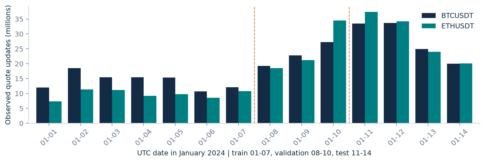
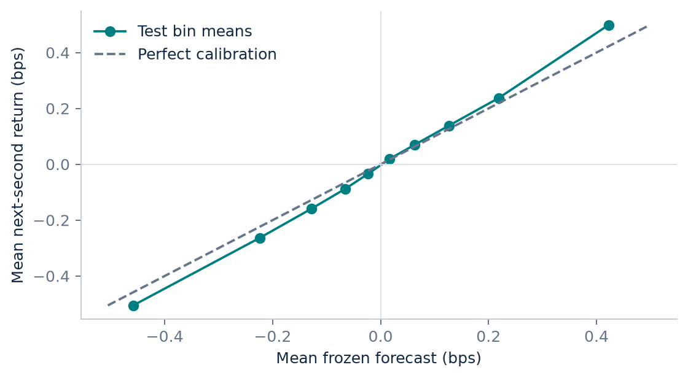
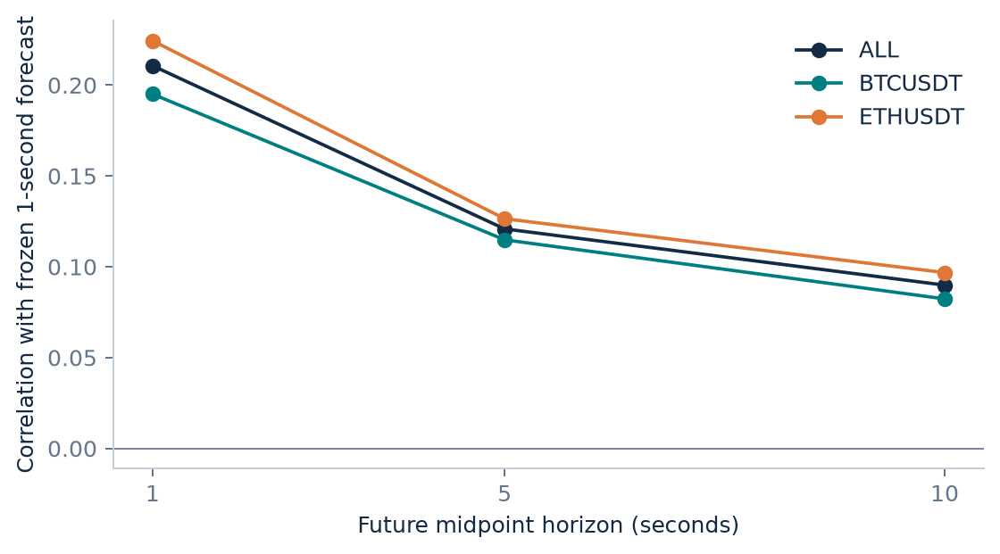
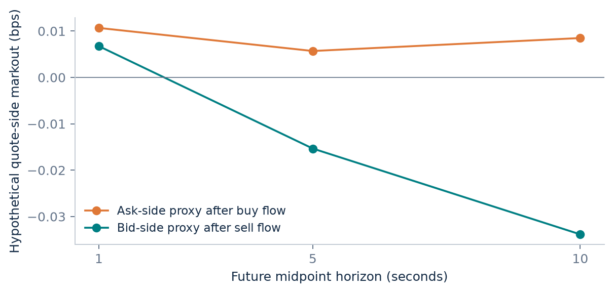
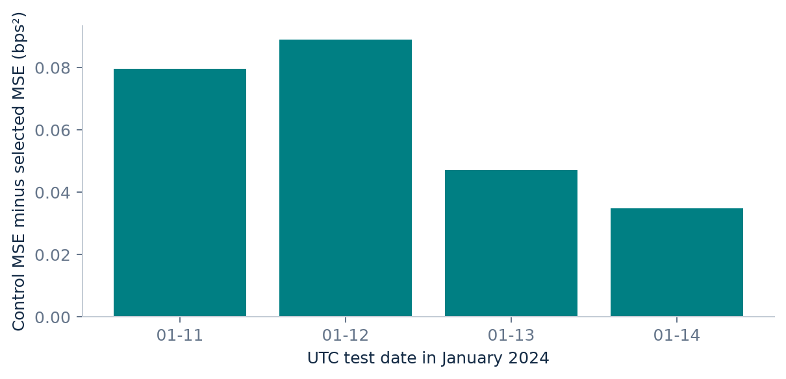

# When does order flow predict prices?

BTC & ETH perpetual futures | January 1-14, 2024

## Question and evidence

Does observed top-of-book order flow improve forecasts of future midpoint changes, and do liquidity conditions change that value? This study separates prediction from contemporaneous price impact and from hypothetical execution economics.

Boosted trees was selected using validation MSE. On the four-day test, its R² relative to a zero-return forecast was 4.416%, and its MSE was 4.437% lower than the price-control Ridge model.

At a one-second assumed entry delay and one basis point of fees per side, the mean hypothetical five-second round trip was -1.9405 bps across 6,091 eligible decisions.

The evidence is restricted to BTCUSDT and ETHUSDT perpetual futures on one venue, January 1-14, 2024. Four test days are insufficient to establish persistent alpha. This independent, AI-assisted project has no affiliation with Citadel Securities, MIT or the data provider.

## Data and provenance

The pipeline processed 538,977,734 BBO updates and 40,271,937 aggregate trade records from 56 vendor-checksummed daily archives (5.96 GB compressed). Data expenditure was $0 against a $100 cap. Raw and per-second datasets remain outside Git; source URLs, checksums and processing audits are committed.

A substantive quality issue was discovered before model fitting: BTCUSDT January 2 interleaves early-day and late-day records. The loader now stops on disorder, performs disk-backed sorting by event time and update ID, and then aggregates the complete chronological stream. No date was removed. The repair and original intermediate files are documented.

All decisions use a one-second UTC grid. Quote event time is an exchange publication proxy, not local receive time. Trade availability is assumed to be transaction time plus 1,000 ms. Quotes published more than one second ago are excluded at endpoints. All observed BBO transitions contribute to OFI before downsampling; archive event completeness is unverified.

Fresh publication does not guarantee fresh market state. Source audits find publication backlogs as large as 128 seconds in training and a sampled BTC 99th-percentile delay of 5.32 seconds on January 9. Published backlogged states remain eligible. Forecasts may partly capture feed catch-up, and the assumed trade delay does not resolve this timing mismatch.

Daily input coverage. Dashed separators show the fixed chronological partitions.

## Research design

Train: January 1-7; validation: January 8-10; test: January 11-14. Training uses every fifth second; validation and test retain every eligible second. Daily features reset with a 60-second warmup. Labels never cross UTC-day boundaries. Median imputation, scaling and regime boundaries use training data only.

The primary target is the next-second midpoint simple return in basis points. The feature families are past returns, spread and volatility; queue imbalance and observed best-quote OFI; lagged signed-trade imbalance and event intensity; log depth and flow/liquidity interactions. Quote-only ablation isolates dependence on trade timing.

Six candidates were fixed before evaluation: zero, price-control Ridge, quote-only Ridge, full-flow Ridge, liquidity-interaction Ridge, and a small histogram gradient boosting model. Ridge alpha is 100. The tree uses 100 iterations, depth 3, 15 maximum leaves, learning rate 0.05 and L2 penalty 10; no random validation or early stopping. The lowest validation-MSE model is retained without refitting.

Retained samples: 241,421 training anchors, 518,023 validation anchors, and 690,678 test anchors. The zero-relative R² is 1 - model MSE / mean(target²); it is not the centered R² used by many libraries.

## Forecast results

Boosted trees was selected using validation MSE. On the four-day test, its R² relative to a zero-return forecast was 4.416%, and its MSE was 4.437% lower than the price-control Ridge model.

The selected model is marked with an asterisk. Other test model comparisons are diagnostic; the test set was not used to choose a model or horizon. All candidates, including failures, are reported.

Quote-only Ridge already captures much of the incremental predictive information. Adding trade features gives a smaller improvement. Liquidity-interaction Ridge performs worse than full-flow Ridge on validation but slightly better on test, so a consistent benefit from those interactions is not established by this sample.

| Model | Validation MSE | Test MSE | Test R² |
| --- | --- | --- | --- |
| Zero forecast | 2.4824 | 1.4115 | 0.000% |
| Price controls | 2.5016 | 1.4119 | -0.023% |
| Quotes only | 2.4461 | 1.3634 | 3.410% |
| + Trade flow | 2.4433 | 1.3625 | 3.473% |
| + Liquidity interactions | 2.4771 | 1.3604 | 3.624% |
| Boosted trees * | 2.4220 | 1.3492 | 4.416% |

One-second test performance. Negative R² indicates worse error than a zero forecast.

## Calibration, horizon and stability

Prediction bins use validation-derived boundaries; their test realized returns show whether forecast magnitudes transfer. The horizon diagnostic compares the same frozen one-second forecast to 1-, 5- and 10-second returns; it does not retrain a model for each horizon.

The equal-day mean improvement over price controls is 0.062646 bps². A descriptive 5,000-resample day-cluster interval is [0.041001, 0.084291] bps². BTC and ETH are resampled together by UTC day. With only four independent day clusters, this interval does not establish statistical significance or long-run stability.

Calibration of the validation-selected model on test observations.

Correlation across horizons, using the unchanged one-second forecast.

## Cost and adverse-selection diagnostics

At a one-second assumed entry delay and one basis point of fees per side, the mean hypothetical five-second round trip was -1.9405 bps across 6,091 eligible decisions.

Decisions occur on a fixed ten-second grid when the absolute forecast exceeds its validation 90th percentile. A long crosses the ask on entry and bid on exit; a short crosses the bid then ask. Delays are 0, 1 or 2 seconds; holding time is five seconds. Fees of 0, 1 or 5 bps per side are scenarios, not historical account fee claims. Each symbol's scenarios have nonoverlapping positions.

These are negligible-size, complete-case calculations conditional on valid future labels and exit quotes. Missing future outcomes are excluded. Extra slippage, impact, receive-time latency, funding, margin and inventory financing are omitted. These are not an ex-ante executable strategy, live fills or realized P&L.

The separate quote-side markout proxy conditions a hypothetical bid or ask execution on recent signed trade flow. It illustrates exposure to subsequent price movement; it is not measured at actual executions and cannot establish fill probability or realized maker returns.

Mean hypothetical return, after crossing both sides of the spread and charging both fees.

Hypothetical quote-side endpoint markouts; no passive fills are assumed or verified.

## What the experiment can support

This project demonstrates a complete research chain: source validation, chronological event reconstruction, causal feature construction, nested baselines, model selection on validation only, a sealed test, and economic diagnostics. A negative net scenario is an informative result, not a reason to hide the experiment.

The principal limits are the short historical window, two correlated instruments, a single venue, base-asset depth units that differ across symbols, and assumed publication timing for trades. Top-of-book updates do not reveal the complete order book, hidden liquidity, queue priority or cancellation intentions. Results do not transfer automatically to US equities or present-day markets.

The next study should add more independent dates and market regimes, validate on a separate venue or licensed equity dataset, and improve receive-time and execution modeling. The $100 budget remains unspent; a paid upgrade should be scoped by a vendor's concrete quote and publication rights.

All four test-day outcomes, clustered jointly across BTC and ETH. Positive means lower error than price controls.

## Reproduction and references

Install Python 3.11+ dependencies with python -m pip install -e '.[dev]'. Run python run.py data, python run.py research, and python run.py report. The data command downloads about 6 GB; derived storage and temporary sorting need additional space. Unit tests run with python -m pytest -q. See README for a fresh-output reproduction workflow; completed test results are protected against accidental overwrite.

The code, configuration, SHA-256 manifests, data audit, preprocessing statistics, model coefficients, daily metrics and result tables are included. The report is generated from results/summary.json and CSV tables without refitting. Generated forecast rows and raw inputs are intentionally not committed.

Sources: Cont, Kukanov & Stoikov, The Price Impact of Order Book Events (arxiv.org/abs/1011.6402); Gould & Bonart, Queue Imbalance as a One-Tick-Ahead Price Predictor (arxiv.org/abs/1512.03492); Binance public-data repository and Vision Dataset Terms, version 1.0, August 26, 2026 (github.com/binance/binance-public-data).

Attribution: historical data provided by Binance Vision. Analytical reports, charts and derived outputs are distributed under CC BY-NC-SA 4.0 and the applicable dataset terms. Independently authored software is MIT licensed. The implementation and documentation were produced with AI assistance; no employment, institutional affiliation or third-party endorsement is implied.
